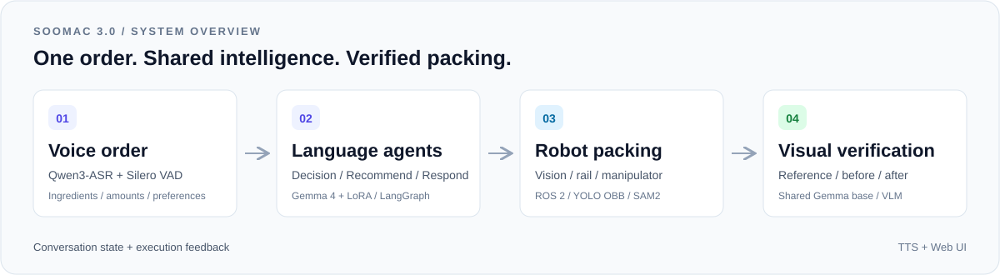
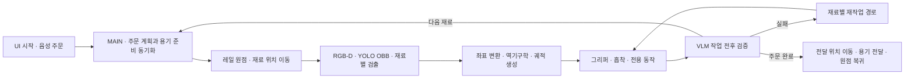
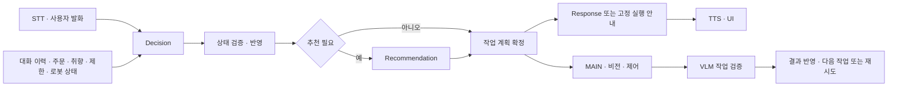
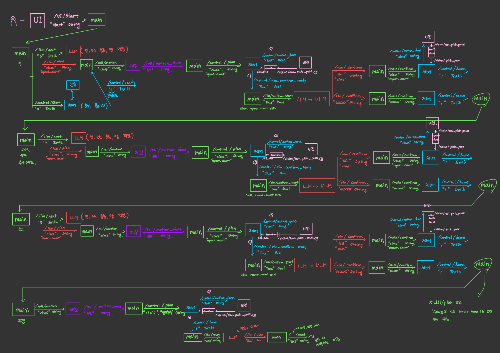

<div align="center">

# SOOMAC 3.0

**LLM·VLM 기반 밀키트 자동 포장 매니퓰레이터**

자연어 주문 · 개인 맞춤 재료 구성 · 로봇 포장 · 작업 결과 검증

2026 지능로봇대회 | 동국대학교 수맥

[개발 환경](#개발-환경) · [빠른 시작](#빠른-시작) · [개발 과정](#개발-과정) · [전체 로직](#전체-로직) · [검증 결과](#검증-결과)

[](#개발-환경)
[](#전체-로직)
[](#langgraph-기반-멀티에이전트-구조)
[](#개발-환경)

</div>

고객의 말에서 **재료·수량·취향·섭취 제한**을 파악해 주문을 구성합니다. LLM이 주문과 실행 의도를 처리하고, 비전·제어가 재료를 포장하며, VLM이 작업 전후 이미지를 비교합니다.



| 자연어 주문 처리 | 로봇 작업 수행 | 작업 결과 검증 |
|---|---|---|
| 주문·수정·추천·확인·실행 의도 | 재료 검출·좌표 변환·레일·매니퓰레이터 | 참조 이미지·작업 전·작업 후 비교 |

**구성:** [AI·대화 — llm_final_2](https://github.com/jisoooxo/IRC_SOOMAC3.0/tree/llm_final_2/src/soomac_irc) · [비전·레일·제어 — main](https://github.com/jisoooxo/IRC_SOOMAC3.0/tree/main/src/irc_control_pkg)

**문서 바로가기:** [실행 환경 명세](docs/ENVIRONMENT.ko.md) · [상세 기술 설명](docs/PROJECT_OVERVIEW.ko.md) · [실제 대화 예시](docs/2026-11-05_verified_multiturn_scenarios.md)

## 개발 환경

| 구성 | 사양 |
|---|---|
| OS / ROS | Ubuntu 22.04 / ROS 2 Humble |
| GPU / Driver | NVIDIA RTX PRO 4500 Blackwell, 32GB / 580.178.04 |
| LLM / VLM | Gemma 4 12B · NF4 양자화 · BF16 계산 |
| STT / TTS | Qwen3-ASR-1.7B + Silero VAD / Fun-CosyVoice3-0.5B-2512 |
| Vision / Control | RealSense RGB-D · YOLO OBB · SAM2 · 6축 Dynamixel · NEMA17 레일 · 흡착 장치 |

| 역할 | Python 환경 | 주요 라이브러리 | 의존성 목록 |
|---|---|---|---|
| LLM 클라이언트 | `soomac_llm` / 3.10.20 | Torch 2.12.1+cu130 · Transformers 5.14.1 · LangGraph 1.0.8 | [requirements](docs/environment/soomac_llm.requirements.txt) |
| 추론 서버 | `soomac_vllm_server` / 3.12.16 | vLLM 0.32.0 · Torch 2.13.0 · Transformers 5.19.0 · vllm-bnb-plugin 0.0.3 | [requirements](docs/environment/soomac_vllm_server.requirements.txt) |
| STT | `gemma4_env` / 3.10.20 | Torch 2.12.1+cu130 · Transformers 5.13.1 | [requirements](docs/environment/gemma4_env.requirements.txt) |
| TTS / UI | `cosyvoice3` / 3.10.19 | Torch 2.10.0 · Transformers 4.51.3 · SoundDevice 0.5.5 | [requirements](docs/environment/cosyvoice3.requirements.txt) |

## 빠른 시작

각 프로세스는 별도 터미널에서 실행합니다.

| 순서 | 프로세스 | 실행 명령 |
|---|---|---|
| 1 | vLLM 서버 | `soomac_vllm_server` |
| 2 | LLM | `soomac_llm` |
| 3 | STT | `stt_qwen` |
| 4 | TTS | `soomac_tts` |
| 5 | Web UI | `soomac_ui` |

**UI:** <http://127.0.0.1:5000> · **모델 서버:** <http://127.0.0.1:8000/health>

## 개발 과정

### 밀키트 시장의 한계 → 해결 방안

미리 조합한 밀키트는 유통기한이 짧은 재료가 전체 판매 기간을 제한하고, 고정 메뉴는 개인 취향·섭취 제한을 반영하기 어렵습니다. **주문 시점에 고객이 고른 재료와 양으로 조합 포장하는 방식**을 개발했습니다.

### LLM 구조 개발 과정

| Tool Calling | Single Agent | Multi Agent |
|---|---|---|
| 도구 호출로 주문 처리 | XGrammar로 JSON 구조화 | 판단·추천·응답 분리 |
| 스트리밍 파싱·복합 요청 처리 한계 | 역할 혼재·일반 대화 대응 한계 | 역할별 상태·입출력 + LangGraph 실행 관리 |

### 대화 로그 기반 데이터셋 구성 및 QLoRA 파인튜닝

**대화 로그 수집 → 불일치 분석 → 데이터 보강 → 역할별 QLoRA 학습 → 테스트·재평가**를 반복했습니다. 발화뿐 아니라 주문 전후 상태를 대조해 수량 변경·추천 수락·실행 의도 사례를 보강했습니다.

| Decision | Recommendation | Response |
|---|---|---|
| epoch6 / step1638 | epoch6 / step234 | best step150 / 약 epoch1.44 |

<details>
<summary><strong>개발 시점 · STT/TTS 선정 · 최적화</strong></summary>

| 시점 | 주요 변화 |
|---|---|
| 2026-08~09 | ROS 통합, 다중 이미지 입력, LoRA 적용 |
| 2026-09-29~10 | LangGraph 멀티에이전트 전환, 상태·추천·대화 이력 보완, Qwen ASR 추가 |
| 2026-11-01~02 | vLLM 추론 최적화와 Unsloth 학습 가속 적용 |
| 2026-11-05 | 역할별 어댑터 운영 적용, 공통 접두 시작 워밍업 |
| 2026-11-19 | 대회 최종본 `b80a8cb` |

**기본 모델 선정 과정:** GPU 메모리 부담을 고려해 언어 처리와 시각 검증이 Gemma 4 12B를 공유합니다. 언어 역할은 별도 LoRA, VLM은 어댑터 없는 기반 모델을 사용합니다.

**STT 모델 선정 과정:** CLOVA API·Nemotron을 비교한 뒤 Qwen3-ASR-1.7B를 선택했습니다. Silero VAD, 300ms 사전 버퍼와 0.8초 무음 종료를 적용합니다. 출력 음성 재인식을 막기 위해 수음 게이트와 버퍼 초기화를 사용합니다.

**TTS 모델 선정 과정:** CosyVoice3 참조 음성 합성을 사용합니다. 숫자·단위·서식을 정규화한 뒤 스트리밍 재생합니다. [TTS vLLM 시험](docs/2026-11-05_tts_vllm_trial_review.md) 결과를 바탕으로 Hugging Face TTS를 사용합니다.

**학습 및 추론 최적화:** Unsloth 학습 가속, vLLM 접두 캐싱(prefix caching), 사용자 입력 전 워밍업을 적용했습니다. [상세 기술 설명](docs/PROJECT_OVERVIEW.ko.md)을 참고해 주세요.

</details>

## 전체 로직

### 주문부터 최종 전달까지

**AI·대화(`llm_final_2`)와 비전·레일·제어(`main`)를 MAIN 상태 머신으로 연결합니다.**



| 단계 | 실제 처리 |
|---|---|
| **1. 주문·초기 준비** | 레일 원점을 잡고, LLM의 첫 계획과 로봇의 초기 용기 이동을 함께 진행합니다. |
| **2. 재료 위치 이동** | 재료별 레일 목표 위치로 이동합니다. 레일 도착·팔 이동 완료·복귀 준비가 맞춰지면 다음 동작을 시작합니다. |
| **3. 검출·좌표 변환** | RGB-D 영상에서 재료별 방식으로 파지점과 방향을 구하고, 카메라 좌표를 로봇 베이스 좌표로 변환합니다. |
| **4. 파지·투입·검증** | 접근·파지·상승·투입 경로를 실행합니다. 재료에 따라 그리퍼·흡착·스푼·소스 전용 경로를 사용하고 VLM 결과를 반영합니다. |
| **5. 다음 작업·최종 전달** | 성공 시 다음 재료로, 실패 시 재작업 경로로 연결합니다. 주문 완료 후 전달 위치에서 용기를 건네고 레일 원점 복귀·상태 초기화를 수행합니다. |

### LangGraph 기반 멀티에이전트 구조



| 역할 | 하는 일 |
|---|---|
| **Decision** | 주문 변경·추천·확인·실행 의도를 구조화합니다. |
| **Recommendation** | 필요할 때 현재 주문과 취향·섭취 제한에 맞는 재료·수량을 제안합니다. |
| **Response** | 실제 반영 결과를 안내하거나 일반 대화에 응답합니다. |
| **공유 상태·실행 관리** | 대화 이력·확정 주문·대기 질문·로봇 상태를 보존하고 실행 조건을 검증합니다. |

**추천 후보 → 주문 확정 → 실행 허용 → 실제 완료**를 별도로 관리합니다. 역할별 모델 호출은 순차 진행하며, 다음 턴에는 이전 대화와 갱신된 상태를 전달합니다.

### Decision Agent — 발화 해석과 실행 판단

**한 발화에서 주문 변경·섭취 제한·추천·실행 의도를 함께 추출합니다.** 모델은 변경할 내용을 구조화하고, 코드는 메뉴·제한·로봇 상태를 검사해 실제 반영과 실행 여부를 결정합니다.

| 순서 | 처리 내용 |
|---|---|
| **1. 문맥 입력** | 현재 발화, 최근 대화 10턴, 확정 주문, 취향·섭취 제한, 확인 대기 질문(`pending`), 현재 작업·대기열·완료 이력을 전달합니다. |
| **2. 의도 구조화** | `task`·`general`·`mixed`를 분류하고, 주문 변경·제한·취향·추천 요청·수락/거절·실행 요청을 JSON으로 출력합니다. XGrammar로 필드·자료형·허용값을 제한합니다. |
| **3. 모순 검사** | 일반 대화인데 주문 변경이 있거나, 실행과 단계 생략을 동시에 요청하는 등 필드 간 모순을 검사합니다. 오류와 이전 출력을 넣어 한 번 재추론하고, 모순이 남으면 확인 질문으로 전환합니다. |
| **4. 상태 반영** | `general`은 주문 변경 없이 응답으로 연결합니다. `task`·`mixed`는 대기 질문을 처리한 뒤 제한·취향·주문 변경을 검증·반영하고, 필요할 때 Recommendation을 호출합니다. |
| **5. 실행 판정** | 실행 의도(`commit`)와 현재 단계의 주문·확인 상태·로봇 가동 상태를 검사합니다. 조건을 충족하면 실행을 허용하고, 주문 변경만 있으면 실행 확인을 기다립니다. |

<details>
<summary><strong>Decision 출력 필드와 JSON 예시</strong></summary>

| 필드 | 의미와 동작 |
|---|---|
| `route` | 필수 필드입니다. `task`는 주문·작업, `general`은 일반 대화, `mixed`는 두 의미가 함께 있는 발화입니다. `mixed`도 주문 검증 경로를 거칩니다. |
| `order` | 이번 발화에서 변경할 재료·수량만 출력합니다. 생략한 항목은 유지하고, `"none"`으로 지정한 선택은 해제합니다. |
| `restrictions` / `preferences` | 섭취 제한과 취향을 `add`·`remove`로 추가·해제합니다. 알레르기·섭취 불가·식이 규칙의 해제는 별도 확인을 거칩니다. |
| `recommendation.action` | `request`는 새 추천, `revise`는 추천 수정입니다. 구체적인 후보는 Recommendation이 생성합니다. |
| `commit` | 현재 단계의 실행 의도입니다. 생략하면 `false`이며, `true`여도 실행 조건 검사를 통과해야 합니다. |
| `confirmation` / `skip_current` | 각각 대기 질문의 `accept`·`reject`와 현재 선택 단계의 생략 요청입니다. 단계 생략은 선택 재료가 없는 야채·육류·추가 재료 단계에서 허용합니다. |
| `clarify` | 의미를 확정하지 못한 경우 `true`로 출력합니다. 주문 변경과 실행을 보류하고 다시 질문합니다. |

**입력:** “면은 얇은면으로 보통 양으로 주고, 소스는 느끼한 걸로 추천해줘.”

Decision 출력 형식 예시입니다.

```json
{
  "route": "task",
  "order": {
    "noodle_type": "얇은면",
    "noodle_portion": "normal"
  },
  "recommendation": {
    "action": "request"
  },
  "commit": false
}
```

면 종류·양은 주문에 반영하고, 소스는 추천 후보를 생성합니다. 실행 요청은 없으므로 로봇 작업을 시작하지 않습니다. 추천 조건인 “느끼한”은 사용자 원문과 대화 이력으로 Recommendation에 전달합니다.

외부 JSON의 `order`는 내부 `order_patch`로 정규화합니다. 중복 JSON 키는 바로 거절하며, 구조적 모순 재추론과 구분합니다.

</details>

#### 확인 대기와 실행 조건

**같은 수락 표현도 직전 질문의 종류에 따라 다르게 처리합니다.**

| 대기 질문 | 수락 시 처리 | 거절 시 처리 |
|---|---|---|
| **추천 확인** | 후보를 주문 변경으로 옮겨 다시 검증합니다. 실행 의도는 별도로 판단합니다. | 후보를 닫습니다. |
| **실행 확인** | 확정 주문에 대한 실행 의도로 처리하고 실행 조건을 검사합니다. | 실행 대기를 닫고 선택한 주문은 유지합니다. |
| **섭취 제한 해제 확인** | 확인한 제한을 해제합니다. 여러 제한은 각각 확인합니다. | 해당 제한을 유지합니다. |

지원 메뉴·수량, 섭취 제한 충돌, 이미 진행한 단계나 실행 중·완료된 재료의 변경 여부를 검사합니다. **유효한 변경은 반영하되 검증 문제가 남으면 해당 턴의 실행은 보류합니다.** 실행 시에는 필수 주문 누락, 현재 실행에 영향을 주는 미확정 질문, 작업 중인 로봇과 대기열도 확인합니다.

### Recommendation Agent — 후보 생성과 수락

**이번 턴의 주문·취향·제한을 반영한 뒤 추천합니다.** 사용자 원문과 최근 대화, 현재 주문, 변경 가능한 재료 범위를 입력받아 후보(`proposal`)와 추천 이유(`reason_tags`)를 생성합니다.

코드는 지원 메뉴·수량·섭취 제한·이미 작업한 재료를 검사하고, 통과한 후보를 `pending`에 저장합니다. 사용자가 수락하면 주문에 반영합니다. 현재 단계 실행과 무관한 미래 단계의 추천은 보류한 채 현재 확정 주문을 실행할 수 있습니다.

### Response Agent — 반영 결과 안내

`task`·`general`·`mixed`에 맞는 프롬프트를 선택합니다. **확정 주문, 이번 턴에 반영한 변경, 추천 후보, 다음 질문, 실제 로봇 상태**를 전달해 응답을 생성합니다.

Response는 주문을 변경하지 않습니다. 실행이 허용된 턴은 현재 작업 목록에서 재료·수량을 읽어 고정 실행 안내를 만들고, 일반 주문 안내·추천·대화는 Response가 생성합니다.

### 대화 판단에서 로봇 계획까지

| 단계·발화 | 주문·질문 처리 | 실행 계획 |
|---|---|---|
| 면 단계: “얇은면은 보통 양으로, 소스는 느끼한 걸로 추천해줘.” | 얇은면·보통 양 확정, 크림 추천 후보 확인 | 실행 없음 |
| “크림으로 선택할게. 바로 담아.” | 크림 선택, 현재 면 단계 실행 승인 | `noodle_thin ×2` |
| 면 완료 후 야채 단계: “양파랑 버섯 둘 다 적게 골라줘.” | 두 재료를 적게 선택하고 실행 확인 | 실행 없음 |
| “버섯만 보통 양으로 바꿔서 바로 담아.” | 양파는 적게 유지, 버섯만 보통으로 변경해 실행 | `onion ×1`, `mushroom ×2` |

수량은 `low`·`normal`·`high`를 **반복 횟수 1·2·3**으로 변환합니다. 현재 단계의 확정 주문을 작업 큐에 넣고, 재료 코드와 `repeat_count`를 MAIN에 하나씩 전달합니다. 반복 횟수는 무게나 재료 개수를 뜻하지 않습니다.

면 → 야채 → 육류 → 추가 재료 → 뚜껑 → 소스 순서로 진행하며, 실행 허용과 실제 완료 상태를 따로 관리합니다.

<details>
<summary><strong>LLM 로직 구현 파일 보기</strong></summary>

| 기능 | 구현 |
|---|---|
| 입력 구성·모델 호출 | [decision_model.py](src/soomac_irc/soomac_irc/decision_model.py) |
| 출력 스키마·정규화 | [agent_contract.py](src/soomac_irc/soomac_irc/agent_contract.py) |
| 재추론·대기 질문·호출 분기 | [llm_langgraph.py](src/soomac_irc/soomac_irc/llm_langgraph.py) |
| 주문·제한·물리 상태 검증 | [llm_policy.py](src/soomac_irc/soomac_irc/llm_policy.py) |
| 추천·응답 입력 / 작업 큐·ROS 계획 | [response_contract.py](src/soomac_irc/soomac_irc/response_contract.py) · [llm_langgraph_node.py](src/soomac_irc/soomac_irc/llm_langgraph_node.py) |

</details>

### 참조 이미지 선정 / 작업 전후 이미지 검증

**재료 이미지 crop → SigLIP2 임베딩 → Chroma DB → 대표 참조 선정**으로 검증 자료를 준비합니다. VLM은 **참조·작업 전·현재 이미지**를 비교해 성공·실패·불확실을 판단합니다.

### 개별 재료 검출 — RGB-D · YOLO OBB · SAM2

RealSense 컬러·깊이 영상(640×480, 30fps)을 정렬하고, 요청된 재료에 맞는 검출 경로를 사용합니다.

| 대상 | 검출·파지점 선정 방식 |
|---|---|
| **소시지·게살 등 개별 재료** | YOLO 회전 경계 상자(OBB) → 가까운 깊이의 후보점 → SAM2 분할 → 실제 크기 검증 → 가까운 물체 선택 |
| **얇은면·넓은면** | 면 OBB 안에서 띠지의 HSV 색상을 구분 → k-means 후보점 15개 → SAM2 분할·크기 검증 |
| **버섯·양파·치즈·소스류의 비전 경로** | SAM2를 건너뛰고 OBB 장축의 1/3·2/3 후보를 번갈아 사용 → 주변 패치의 최소 유효 깊이로 3D 위치 계산 |
| **뚜껑** | 검정색 HSV·깊이·관심 영역 마스크 → 컨투어 → 3D 평면 피팅 → 실제 크기·거리 기준 후보 선정 |

검출 결과는 **6프레임 누적 후 위치·각도의 중앙값**으로 전달합니다. 소스는 제어부의 전용 좌표 경로를 사용합니다.

### 레일 이동과 공정 동기화

[rail_node.py](https://github.com/jisoooxo/IRC_SOOMAC3.0/blob/main/src/irc_control_pkg/irc_control_pkg/rail_node.py)는 재료 이름을 **원점 기준 절대 회전수**로 바꿔 Arduino에 전달합니다. 펌웨어는 **NEMA17 + TB6560 + AccelStepper**로 원점 센서와 가감속 이동을 처리합니다.

| 기능 | 처리 방식 |
|---|---|
| **원점 정렬** | 원점 센서 감지 위치를 0으로 설정하고 완료 응답을 보냅니다. |
| **재료·전달 위치 이동** | 재료별 고정 목표값 또는 최종 `handoff` 위치로 이동합니다. |
| **선행 이동·대기열** | 미리 이동하는 요청을 지원하며, 이동 중 받은 명령은 큐에 보관합니다. |
| **MAIN과 동기화** | 일반 이동 완료를 MAIN에 알리고, MAIN은 팔 복귀·이동 완료 조건과 함께 다음 동작을 결정합니다. |

### 좌표 변환 · 경로 계획 · 매니퓰레이터 제어

**카메라 3D 좌표 + 현재 관절각 → 베이스 좌표 → 역기구학(IK) → 접근·파지·상승·투입 궤적 → 모터·도구 동작**으로 연결합니다.

| 구성 | 담당 기능 |
|---|---|
| **좌표 변환** | 현재 관절각의 순기구학(FK)과 카메라 장착 변환을 적용해 위치·방향을 로봇 좌표로 변환합니다. |
| **경로 계획·기구학** | 재료별 파지 방식과 목표 자세를 선택하고, 관절 제한·연속성을 고려해 웨이포인트를 계산합니다. |
| **궤적·하드웨어 제어** | 5차 다항식 궤적으로 관절 이동을 보간하고 Dynamixel·그리퍼·Arduino 흡착 명령을 실행합니다. |
| **추가 재료·소스·전달** | 치즈·페퍼론치노의 스푼 경로, 소스 전용 픽앤플레이스, 최종 용기 전달·복귀를 별도 경로로 처리합니다. |

<details>
<summary><strong>main 브랜치 구현 파일 보기</strong></summary>

| 기능 | 구현 파일 |
|---|---|
| 전체 공정 상태 머신 | [soomac_main_node.py](https://github.com/jisoooxo/IRC_SOOMAC3.0/blob/main/src/irc_control_pkg/irc_control_pkg/soomac_main_node.py) |
| 재료 검출 / 뚜껑 인식 | [object_detection_node.py](https://github.com/jisoooxo/IRC_SOOMAC3.0/blob/main/src/irc_control_pkg/irc_control_pkg/object_detection_node.py) · [cover_detect.py](https://github.com/jisoooxo/IRC_SOOMAC3.0/blob/main/src/irc_control_pkg/irc_control_pkg/cover_detect.py) |
| 레일 ROS 노드 / 펌웨어 | [rail_node.py](https://github.com/jisoooxo/IRC_SOOMAC3.0/blob/main/src/irc_control_pkg/irc_control_pkg/rail_node.py) · [rail_v2.ino](https://github.com/jisoooxo/IRC_SOOMAC3.0/blob/main/src/irc_control_pkg/irc_control_pkg/arduino/rail_v2/rail_v2.ino) |
| 좌표 변환 / 경로 계획 / 기구학 | [transform_node.py](https://github.com/jisoooxo/IRC_SOOMAC3.0/blob/main/src/irc_control_pkg/irc_control_pkg/transform_node.py) · [motion_planner_node.py](https://github.com/jisoooxo/IRC_SOOMAC3.0/blob/main/src/irc_control_pkg/irc_control_pkg/motion_planner_node.py) · [kinematics_irc.py](https://github.com/jisoooxo/IRC_SOOMAC3.0/blob/main/src/irc_control_pkg/irc_control_pkg/kinematics_irc.py) |
| 궤적 / 모터·도구 제어 | [motion_trajectory.py](https://github.com/jisoooxo/IRC_SOOMAC3.0/blob/main/src/irc_control_pkg/irc_control_pkg/motion_trajectory.py) · [arm_controller_node.py](https://github.com/jisoooxo/IRC_SOOMAC3.0/blob/main/src/irc_control_pkg/irc_control_pkg/arm_controller_node.py) |

</details>

<details>
<summary><strong>전체 노드 연결 도식 보기</strong></summary>



[원본 크기로 열기](docs/assets/system-flow.png)

</details>

## 검증 결과

### 복합 발화 및 멀티턴 대화 평가 결과

| 필수 주문·실행 | 누적 상태·계획·실행 | 누적 전체 계약 |
|:---:|:---:|:---:|
| **17 / 17턴** | **80 / 82턴** | **77 / 82턴** |

실제 모델 출력으로 상태·대화 이력을 이어서 평가했습니다. 짧은 수락 표현의 실행 시점과 일부 대화 분류 오류는 남아 있습니다. [평가·운영 적용 기록](docs/2026-11-05_d6_prompt_adoption.md).

### 학습 및 추론 최적화

| 측정 | 결과 |
|---|---|
| HF 캐시 ON → vLLM 캐시 ON | 동일 입력 warm 24회 합계 **34.36초 → 14.76초** |
| 공통 접두 시작 워밍업 | 준비 **5.79초**, 후속 첫 D→Q→P **2.839초** |
| 음성 모델 상주 시나리오 | 네 조건·5개 시나리오 합계 **144 / 144턴** |

추론 시간은 음성 재생·로봇 동작을 제외한 값이며, 시나리오 결과는 대화 평가 기준입니다. [HF/vLLM 비교](docs/2026-11-05_hf_vllm_compare_review.md) · [시작 워밍업](docs/2026-11-05_startup_warmup_plan.md) · [음성 상주 시험](docs/2026-11-05_full_scenario_audio_warmup_review.md).

<details>
<summary><strong>저장소 구성 · 용어 정리 · 참고 자료</strong></summary>

| 경로 | 역할 |
|---|---|
| [src/soomac_irc](src/soomac_irc) | LLM·VLM·음성·UI·상태 계약·관련 테스트 |
| [main: src/irc_control_pkg](https://github.com/jisoooxo/IRC_SOOMAC3.0/tree/main/src/irc_control_pkg) | 공정 상태 머신·레일·비전·SAM2·좌표 변환·경로 계획·하드웨어 제어 |
| [tools](tools) | vLLM 시작·어댑터 변환·학습·평가 도구 |
| [docs](docs) | 실행 명세·설계·이력·검증 결과 |
| [models](models) | 모델 선택 기록과 로컬 어댑터 배치 |

### 용어 정리

| 용어 | 의미 |
|---|---|
| LLM / VLM | 자연어 주문을 처리하는 언어 모델 / 이미지를 함께 해석하는 시각 언어 모델입니다. |
| 에이전트(agent) / 어댑터(adapter) | 판단·추천·응답 역할 / 해당 역할의 LoRA 가중치입니다. |
| 상태(state) / 대화 이력(history) | 확정 주문·제한·대기 질문·작업 상황 / 이전 발화·응답입니다. |
| QLoRA / 양자화(quantization) | 양자화된 모델 위의 LoRA 학습 / 가중치 메모리를 줄이는 표현 방식입니다. |
| 접두 캐싱(prefix caching) / 워밍업(warmup) | 공통 입력 앞부분의 KV 캐시 재사용 / 사용자 입력 전에 경로를 준비하는 호출입니다. |

참고 자료: **IRC PPT 최종**(2026-11-13) · 저장소 코드 · 실행·평가 기록

</details>
