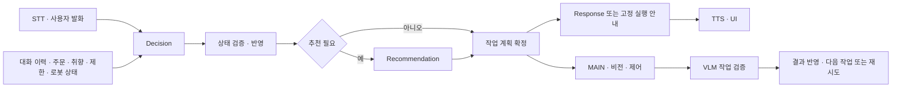

<div align="center">

# SOOMAC 3.0

**LLM·VLM 기반 밀키트 자동 포장 매니퓰레이터**

자연어 주문 · 개인 맞춤 재료 구성 · 로봇 포장 · 작업 결과 검증

2026 지능로봇대회 | 동국대학교 수맥

[개발 환경](#개발-환경) · [빠른 시작](#빠른-시작) · [개발 과정](#개발-과정) · [전체 로직](#전체-로직) · [검증 결과](#검증-결과)

[](#개발-환경)
[](#전체-로직)
[](#langgraph-기반-멀티에이전트-구조)
[](#개발-환경)

</div>

고객의 말에서 **재료·수량·취향·섭취 제한**을 파악해 주문을 구성한다. LLM이 주문과 실행 의도를 처리하고, 비전·제어가 재료를 포장하며, VLM이 작업 전후 이미지를 비교한다.


| 자연어 주문 처리 | 로봇 작업 수행 | 작업 결과 검증 |
|---|---|---|
| 주문·수정·추천·확인·실행 의도 | 재료 검출·좌표 변환·레일·매니퓰레이터 | 참조 이미지·작업 전·작업 후 비교 |

**문서 바로가기:** [실행 환경 명세](docs/ENVIRONMENT.ko.md) · [상세 기술 설명](docs/PROJECT_OVERVIEW.ko.md) · [실제 대화 예시](docs/2026-11-05_verified_multiturn_scenarios.md)

## 개발 환경

**이전에 실행한 버전을 그대로 사용한다.** 기준은 2026-11-05 실행·평가 기록이며, 소스 기준은 대회 최종본 `b80a8cb`(2026-11-19)이다.

| 구성 | 기존 실행 환경 |
|---|---|
| OS / ROS | Ubuntu 22.04 / ROS 2 Humble |
| GPU / Driver | NVIDIA RTX PRO 4500 Blackwell, 32623MiB / `580.178.04` |
| LLM / VLM | Gemma 4 12B · NF4 양자화 · BF16 계산 · 공통 기반 모델 |
| STT / TTS | Qwen3-ASR-1.7B + Silero VAD / Fun-CosyVoice3-0.5B-2512 |
| Vision / Control | RGB-D 카메라 · YOLO OBB · SAM2 · 6축 매니퓰레이터 · 레일 · 흡착 장치 |

### 역할별 실행 버전

| 역할 | Python 환경 | 주요 버전 | 전체 기록 |
|---|---|---|---|
| LLM 클라이언트 | `soomac_llm` / 3.10.20 | Torch 2.12.1+cu130 · Transformers 5.14.1 · LangGraph 1.0.8 | [148개](docs/environment/soomac_llm.requirements.txt) |
| 추론 서버 | `soomac_vllm_server` / 3.12.16 | vLLM 0.32.0 · Torch 2.13.0 · Transformers 5.19.0 · vllm-bnb-plugin 0.0.3 | [202개](docs/environment/soomac_vllm_server.requirements.txt) |
| STT | `gemma4_env` / 3.10.20 | Torch 2.12.1+cu130 · Transformers 5.13.1 | [217개](docs/environment/gemma4_env.requirements.txt) |
| TTS / UI | `cosyvoice3` / 3.10.19 | Torch 2.10.0 · Transformers 4.51.3 · SoundDevice 0.5.5 | [229개](docs/environment/cosyvoice3.requirements.txt) |

기존 Conda 환경과 외부 모델을 유지한다. 위 파일은 당시 설치 버전 기록이다. 다른 PC로 옮길 때 필요한 자산·ROS·오디오·시리얼 설정은 [환경 명세서](docs/ENVIRONMENT.ko.md)에 있다.

## 빠른 시작

### 코드 받기

```bash
git clone --branch llm_final_2 https://github.com/jisoooxo/IRC_SOOMAC3.0.git
cd IRC_SOOMAC3.0
```

이 자리에서 살아있는 변수: 사용자 정의 변수 없음. 최종 LLM 코드가 있는 `llm_final_2`를 명시한다.

모델 가중치·역할별 어댑터·음성 모델·참조 이미지 DB는 별도로 준비한다. **기존 개발 PC는 이미 준비된 환경과 자산을 재사용한다.** [자산 경로 확인 →](docs/ENVIRONMENT.ko.md#3-모델외부-자산과-파일-경로)

### 기존 개발 PC에서 실행

각 명령은 **별도 Bash 터미널**에서 실행한다. 서버 준비 후 LLM·음성·UI를 시작한다.

| 순서 | 프로세스 | 실행 명령 |
|---|---|---|
| 1 | vLLM 서버 | `source ~/.bashrc && soomac_vllm_server` |
| 2 | LLM | `source ~/.bashrc && soomac_llm` |
| 3 | STT | `source ~/.bashrc && stt_qwen` |
| 4 | TTS | `source ~/.bashrc && soomac_tts` |
| 5 | Web UI | `source ~/.bashrc && soomac_ui` |

이 자리에서 살아있는 명령: 다섯 함수·별칭은 기존 PC의 `~/.bashrc`에서 정의된다. `source`로 같은 터미널에 불러온다. 새 clone에 해당 셸 설정이 설치되는 것은 아니다.

**UI:** <http://127.0.0.1:5000> · **모델 서버:** <http://127.0.0.1:8000/health>

<details>
<summary><strong>실행 전 확인 · 서버 설정 · 로봇 연결</strong></summary>

```bash
curl --fail http://127.0.0.1:8000/health
curl --fail http://127.0.0.1:8000/v1/models
```

이 자리에서 살아있는 변수: 사용자 정의 변수 없음. `gemma4-base`와 세 어댑터의 등록을 확인한다.

| 설정 | 기존 값 |
|---|---|
| 입력+출력 토큰 한도 | 16384 |
| GPU 메모리 예약률 | 0.58 |
| 접두 캐싱 / 시작 워밍업 / batch invariant | ON / ON / ON |
| 실행 시작 안내 | 기존 고정 안내 유지 |

12K/0.50은 별도 시험 후보이며 운영 기본값에 적용하지 않았다. [동시 부하 결과](docs/2026-11-05_stack_vram_12k_review.md)를 참고한다.

MAIN·레일·비전·로봇 제어 프로세스가 연결돼야 실물 포장이 진행된다. TTS 실행 함수에는 기존 장치 프로필 전환·복구도 포함돼 있다. 셸 함수 없이 실행하는 명령과 외부 제어 자산은 [환경 명세서 §5](docs/ENVIRONMENT.ko.md#5-준비와-실행-순서)에 있다.

</details>

## 개발 과정

### 밀키트 시장의 한계 → 해결 방안

미리 조합한 밀키트는 유통기한이 짧은 재료가 전체 판매 기간을 제한하고, 고정 메뉴는 개인 취향·섭취 제한을 반영하기 어렵다. **주문 시점에 고객이 고른 재료와 양으로 조합 포장하는 방식**을 개발했다.

### LLM 구조 개발 과정

| Tool Calling | Single Agent | Multi Agent |
|---|---|---|
| 도구 호출로 주문 처리 | XGrammar로 JSON 구조화 | 판단·추천·응답 분리 |
| 스트리밍 파싱·복합 요청 처리 한계 | 역할 혼재·일반 대화 대응 한계 | 역할별 상태·입출력 + LangGraph 실행 관리 |

### 대화 로그 기반 데이터셋 구성 및 QLoRA 파인튜닝

**대화 로그 수집 → 불일치 분석 → 데이터 보강 → 역할별 QLoRA 학습 → 테스트·재평가**를 반복했다. 발화뿐 아니라 주문 전후 상태를 대조해 수량 변경·추천 수락·실행 의도 사례를 보강했다.

| Decision | Recommendation | Response |
|---|---|---|
| epoch6 / step1638 | epoch6 / step234 | best step150 / 약 epoch1.44 |

<details>
<summary><strong>개발 시점 · STT/TTS 선정 · 최적화</strong></summary>

| 시점 | 주요 변화 |
|---|---|
| 2026-08~09 | ROS 통합, 다중 이미지 입력, LoRA 적용 |
| 2026-09-29~10 | LangGraph 멀티에이전트 전환, 상태·추천·대화 이력 보완, Qwen ASR 추가 |
| 2026-11-01~02 | vLLM 추론 최적화와 Unsloth 학습 가속 적용 |
| 2026-11-05 | 역할별 어댑터 운영 적용, 공통 접두 시작 워밍업 |
| 2026-11-19 | 대회 최종본 `b80a8cb` |

**기본 모델 선정 과정:** GPU 메모리 부담을 고려해 언어 처리와 시각 검증이 Gemma 4 12B를 공유한다. 언어 역할은 별도 LoRA, VLM은 어댑터 없는 기반 모델을 사용한다.

**STT 모델 선정 과정:** CLOVA API·Nemotron을 비교한 뒤 Qwen3-ASR-1.7B를 선택했다. Silero VAD, 300ms 사전 버퍼와 0.8초 무음 종료를 적용한다. 출력 음성 재인식을 막기 위해 수음 게이트와 버퍼 초기화를 사용한다.

**TTS 모델 선정 과정:** CosyVoice3 참조 음성 합성을 사용한다. 숫자·단위·서식을 정규화한 뒤 스트리밍 재생한다. [TTS vLLM 시험](docs/2026-11-05_tts_vllm_trial_review.md) 이후에도 기존 Hugging Face TTS를 유지했다.

**학습 및 추론 최적화:** Unsloth 학습 가속, vLLM 접두 캐싱(prefix caching), 사용자 입력 전 워밍업을 적용했다. [상세 기술 설명](docs/PROJECT_OVERVIEW.ko.md)을 참고한다.

</details>

## 전체 로직

### LangGraph 기반 멀티에이전트 구조



| 역할 | 하는 일 |
|---|---|
| **Decision** | 주문 변경·추천·확인·실행 의도를 구조화한다. |
| **Recommendation** | 필요할 때 현재 주문과 취향·섭취 제한에 맞는 재료·수량을 제안한다. |
| **Response** | 실제 반영 결과를 안내하거나 일반 대화에 응답한다. |
| **공유 상태·실행 관리** | 대화 이력·확정 주문·대기 질문·로봇 상태를 보존하고 실행 조건을 검증한다. |

**추천 후보 → 주문 확정 → 실행 허용 → 실제 완료**를 별도로 관리한다. 역할별 모델 호출은 순차 진행하며, 다음 턴에는 이전 대화와 갱신된 상태를 전달한다.

(내가 의역해보자면, “치즈를 추천받음”과 “지금 치즈를 담음”을 같은 상태로 취급하지 않는 것이다.)

### 참조 이미지 선정 / 작업 전후 이미지 검증

**재료 이미지 crop → SigLIP2 임베딩 → Chroma DB → 대표 참조 선정**으로 검증 자료를 준비한다. VLM은 **참조·작업 전·현재 이미지**를 비교해 성공·실패·불확실을 판단한다.

### 개별 재료 검출 / 뚜껑 인식

개별 재료는 **YOLO OBB → 깊이 기반 후보점 → SAM2 분할 → 실제 크기 비교 → 좌표 변환**을 거쳐 제어에 전달한다. 뚜껑 인식은 색상·깊이 마스크·모폴로지·컨투어·평면 fitting으로 구성한다.

<details>
<summary><strong>전체 노드 연결 도식 보기</strong></summary>


발표용 기존 흐름도 `토픽_vlm 추가 v2.pdf`를 정적 이미지로 수록했다. [원본 크기로 열기](docs/assets/system-flow.png).

</details>

## 검증 결과

### 복합 발화 및 멀티턴 대화 평가 결과

| 필수 주문·실행 | 누적 상태·계획·실행 | 누적 전체 계약 |
|:---:|:---:|:---:|
| **17 / 17턴** | **80 / 82턴** | **77 / 82턴** |

실제 모델 출력으로 상태·대화 이력을 이어서 평가했다. 짧은 수락 표현의 실행 시점과 일부 대화 분류 오류는 남아 있다. [평가·운영 적용 기록](docs/2026-11-05_d6_prompt_adoption.md).

### 학습 및 추론 최적화

| 측정 | 기존 실행에서 확인한 결과 |
|---|---|
| HF 캐시 ON → vLLM 캐시 ON | 동일 입력 warm 24회 합계 **34.36초 → 14.76초** |
| 공통 접두 시작 워밍업 | 준비 **5.79초**, 후속 첫 D→Q→P **2.839초** |
| 음성 모델 상주 시나리오 | 네 조건·5개 시나리오 합계 **144 / 144턴** |

각 수치는 해당 시험 조건의 관측값이다. 첫 두 행은 STT·TTS·실물 로봇 시간을 포함하지 않는다. 음성 상주 시험도 마이크부터 실물 작업까지의 전체 검증은 아니다. [HF/vLLM 비교](docs/2026-11-05_hf_vllm_compare_review.md) · [시작 워밍업](docs/2026-11-05_startup_warmup_plan.md) · [음성 상주 시험](docs/2026-11-05_full_scenario_audio_warmup_review.md).

<details>
<summary><strong>저장소 구성 · 용어 정리 · 참고 자료</strong></summary>

| 경로 | 역할 |
|---|---|
| [src/soomac_irc](src/soomac_irc) | LLM·VLM·음성·UI·상태 계약·관련 테스트 |
| [src/irc_control_pkg](src/irc_control_pkg) | MAIN·제어·비전·좌표 변환 |
| [tools](tools) | vLLM 시작·어댑터 변환·학습·평가 도구 |
| [docs](docs) | 실행 명세·설계·이력·검증 결과 |
| [models](models) | 모델 선택 기록과 로컬 어댑터 배치 |

### 용어 정리

| 용어 | 의미 |
|---|---|
| LLM / VLM | 자연어 주문을 처리하는 언어 모델 / 이미지를 함께 해석하는 시각 언어 모델이다. |
| 에이전트(agent) / 어댑터(adapter) | 판단·추천·응답 역할 / 해당 역할의 LoRA 가중치이다. |
| 상태(state) / 대화 이력(history) | 확정 주문·제한·대기 질문·작업 상황 / 이전 발화·응답이다. |
| QLoRA / 양자화(quantization) | 양자화된 모델 위의 LoRA 학습 / 가중치 메모리를 줄이는 표현 방식이다. |
| 접두 캐싱(prefix caching) / 워밍업(warmup) | 공통 입력 앞부분의 KV 캐시 재사용 / 사용자 입력 전에 경로를 준비하는 호출이다. |

프로젝트 내용은 **IRC PPT 최종**(2026-11-13)과 저장소 코드·실행 기록을 바탕으로 한다. 소개·목차·실행 예제의 배치는 [Hugging Face TEI README](https://github.com/huggingface/text-embeddings-inference)를 참고했다. 발표 자료의 동영상은 포함하지 않는다.

</details>
