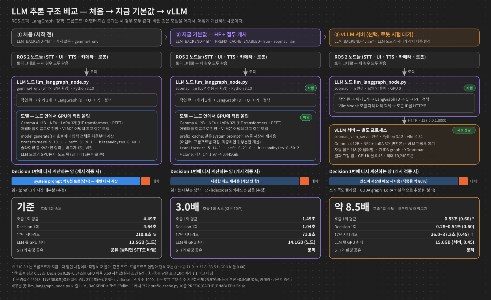
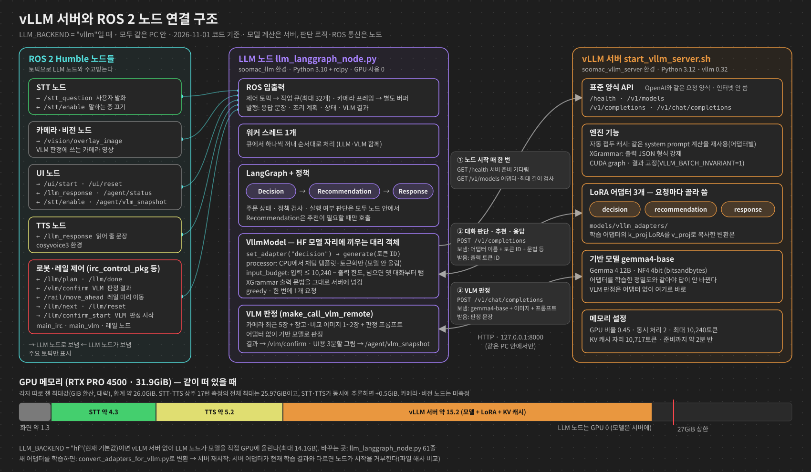

# LLM 추론 속도 변천사 — 무엇을 왜 바꿨고 얼마나 빨라졌나

[그림·차트 판(HTML)](2026-11-01_llm_inference_speed_history.html) · [상세 본문](2026-11-01_llm_inference_acceleration.md) · [작업 기록](2026-11-01_llm_inference_acceleration_worklog.md) · [근거 파일](2026-11-01_accel_evidence/)
→ **같은 모델·같은 어댑터로 응답 대기 시간을 줄인 과정.** 대답의 정확도(데이터·프롬프트·학습)는 이 문서의 범위가 아니다.

작성 2026-11-01, 브랜치 `llm_final_2`(미커밋). 대상: 팀원. 숫자는 이 PC(RTX PRO 4500 Blackwell 32GB)의 측정값이다. 배수·비율은 측정값으로 계산했고, 추정은 "추정"이라고 적었다. 각 절 끝의 `§`는 상세 본문의 절 번호다.

> 학습 속도(배치·체크포인팅 설정, `*_speed_settings.md`)는 다른 이야기다. 이 문서는 **로봇이 대답할 때의 추론 속도**만 다룬다.

---

## 0. 한눈에 보기

| 단계 | 바꾼 것 | Decision 1회 | 17턴 시나리오 | 최대 GPU 메모리 | 지금 상태 |
| --- | --- | ---: | ---: | ---: | --- |
| 0. 시작 전 | HF transformers 5.13.1, 캐시 없음 | 4.64초 | 210.8초 ※1 | 13.5GB(노드) | — |
| 1. 접두 캐시 | 매번 같은 system prompt 계산을 재사용 | 1.43초 | 99.5~103.0초 | 21.8GB(노드) | 2단계에 흡수 |
| 2. 새 환경 `soomac_llm` | 라이브러리 버전 정리 + 캐시 메모리 정리 | 1.04초 | 71.9초 | 14.1GB(노드) | **기본값**(`LLM_BACKEND="hf"`) |
| 3. vLLM 서버 | 추론 전용 엔진(NF4·LoRA 3개 그대로) | 0.28~0.54초 | 33.5초(0.60) / 37.2초(0.45) ※2 | 25.97GiB(PC 전체) | 선택(`"vllm"`), 로봇 시험 대기 |
| 3+. 결과 고정 | 같은 입력이면 매번 같은 답 | — | 36.0초(0.45) | 25.8GiB(PC 전체) | vLLM 서버 기본 켬 |

- ※1 210.8초는 프롬프트가 지금보다 짧던 시점의 값이라 아래 단계와 직접 나누면 안 된다. **같은 코드·같은 프롬프트로 연달아 잰 비교**는 1→2(103.0 → 71.9초)와 2→3(71.9 → 33.5초)이다.
- ※2 0.60·0.45는 vLLM이 GPU 메모리를 얼마나 잡을지 정하는 비율이다. 0.60은 27GiB 상한을 넘어 측정용으로만 썼고, 운영값은 0.45다(§4).
- 메모리 열: "노드"는 LLM 노드 하나, "PC 전체"는 vLLM 서버 + STT + TTS + 화면을 합친 값이라 직접 비교하지 않는다.



구조 비교 그림: [SVG](2026-11-01_llm_architecture_compare.svg) · [PNG](2026-11-01_llm_architecture_compare.png)

같은 실제 로그 입력으로 잰 호출 1회 평균(캐시가 맞는 경우):

```text
원래 HF        ████████████████████████████████████████████  4.49초  (10건)
+ 캐시·새 환경 ███████████████                                1.49초  (같은 10건, 3.0배)
vLLM           █████                                          0.53초  (실제 조건 6건, 약 8.5배)
```

vLLM 줄은 측정 건수가 달라(6건) 1:1 비교가 아니다. 대략의 크기로 본다.

- 한 턴(Decision → Response): 옛 로그 기준 약 9.3초 → 2.6초(캐시·새 환경), 현재 17턴 중앙값 기준 3.14초 → 1.33초(HF → vLLM 0.60)
- VLM 판정 1회: 합성 이미지로 환경만 비교 2.90 → 2.42초 / 실제 카메라 이미지 8종으로 HF → vLLM 비교 2.53 → 1.56초(판정 8/8 동일)

---

## 1. 왜 느렸나 — 먼저 원리 두 개

### 1.1 LLM은 두 단계로 일한다

| 단계 | 하는 일 | 비유 | 우리 경우 (Decision, 추정) |
| --- | --- | --- | --- |
| **prefill**(읽기) | 입력 토큰 전체를 한 번에 읽고, 토큰마다 "메모"(K·V 값)를 만든다 | 시험지 지문을 처음부터 끝까지 읽기 | 입력 6천~8천 토큰. 약 2.5~3초 |
| **decode**(쓰기) | 메모를 보면서 출력 토큰을 한 개씩 만든다 | 답을 한 글자씩 쓰기 | 출력 약 20토큰. 토큰당 약 75ms |

이 "메모"를 **KV 캐시**라고 부른다. 다음 토큰을 만들 때 앞 토큰들의 메모를 **다시 계산하지 않고 읽기만** 한다.
위 시간은 계측기로 직접 나눈 값이 아니라 로그 회귀와 마이크로벤치를 조합한 추정이다(§3.2).

### 1.2 입력의 80~97%가 매번 똑같았다

| Agent | 전체 입력 | 매번 같은 앞부분(system prompt) |
| --- | ---: | ---: |
| Decision | 6,209~6,481 | 6,040 (93~97%) |
| Recommendation | 3,832 | 3,338 (87%) |
| Response task | 5,962~6,611 | 5,280 (80~89%) |

(당시 측정값. 지금은 프롬프트가 늘어 Decision 약 8천 토큰)

system prompt는 프로그램이 켜질 때 정해지고 바뀌지 않는다. 바뀌는 건 뒤에 붙는 대화 기록·주문 상태·이번 발화뿐이다. **그런데 매 호출마다 6천 토큰짜리 같은 지문을 처음부터 다시 읽고 있었다.**

원인: 기존 코드는 호출마다 `model.generate()`를 새로 불러 이전 메모를 버렸다
결과: 이 반복을 없애는 것이 가장 큰 개선이 될 것으로 보고 1단계부터 시작했다 (§3)

---

## 2. 1단계 — 접두 KV 캐시 (HF 안에서)

### 원리

- 같은 앞부분(접두)의 메모(KV)는 한 번만 만들어 저장해 두고, 다음 호출에서는 **달라지는 뒷부분만** 읽는다.
- 지문을 한 번 읽어 두고, 다음 문제부터는 새로 붙은 질문만 읽는 것과 같다.

### 구현에서 지킨 조건

1. **어댑터마다 따로 저장**: LoRA 어댑터가 바뀌면 같은 문장이라도 메모 값이 달라진다. 그래서 (어댑터 이름, system prompt 해시)마다 따로 둔다. 프롬프트가 바뀌면 해시가 달라져 자동으로 새로 만든다.
2. **토큰 단위로 앞부분이 완전히 같을 때만** 재사용한다. 다르면 기존 방식으로 처음부터 계산한다.
3. 끄는 스위치: `prefix_cache.py`의 `PREFIX_CACHE_ENABLED = False`.

### 결과

| | 끔 | 켬 |
| --- | ---: | ---: |
| Decision 1회 | 5.1~7.6초 | 1.0~3.5초 |
| 한 턴(Decision + Response) | 10.4~14.1초 | 2.8~6.7초 |
| 최대 GPU | 13.5GB | **21.9GB** |

### 함정 두 개

- **메모리가 8GB 늘었다.** transformers 5.13.1 버그 때문이다(2단계에서 해결).
- **출력이 가끔 달라진다.** 캐시를 쓰면 "6천 토큰을 한 번에 계산"하던 것이 "6천 + 나머지"로 나뉜다. 4bit(NF4)·bf16 행렬곱은 한 번에 계산하는 줄 수에 따라 덧셈 순서가 달라져 소수점 끝자리가 바뀐다. 두 후보 토큰의 점수가 거의 같은 지점에서는 이 차이로 1등이 뒤집힌다.
  - 예: "소시지만 많이 골라줘" → 캐시를 켜면 소시지를 식단 제한으로 등록(17턴 중 1지점)
  - 캐시를 끈 결과가 "정답"인 것도 아니다. 원래 `generate()`도 decode 단계마다 같은 크기의 차이를 겪는다.
  - 다음 토큰 점수를 직접 비교해, 이번 차이가 구현 실수가 아니라 계산 순서 차이임을 확인했다(§7).

원인: 속도를 바꾸는 거의 모든 방법(캐시·엔진·양자화)은 계산 순서를 바꾼다
결과: **채택 판정은 "토큰이 똑같나"가 아니라 "17턴 시나리오에서 주문·실행·commit 값이 같나"로 한다.** 이 기준은 이후 모든 단계에 썼다 (§5~8)

---

## 3. 2단계 — 새 환경 `soomac_llm` + 캐시 메모리 정리

### 원리: Gemma 4의 두 종류 층

| 층 | 개수 | 보는 범위 | 필요한 메모 |
| --- | ---: | --- | --- |
| 슬라이딩 층 | 40 | 최근 1,024토큰만 | 지난 1,023토큰 것(+ 지금 토큰 = 창 1,024) |
| 글로벌 층 | 8 | 처음부터 전부 | 전부 |

transformers 5.13.1은 버그(`layer_types[:-0]`이 빈 목록이 됨)로 **슬라이딩 층도 메모를 전부 저장**했다. Decision 접두 캐시 하나가 1.97GiB였다.

### 한 일

1. 5.14.0에서 고쳐진 것을 확인하고, **기존 `gemma4_env`는 그대로 둔 채** LLM 노드 전용 새 환경 `soomac_llm`을 설치했다(라이브러리 내용은 §4).
2. 업그레이드만으로는 메모리가 안 줄었다. 잘라낸 메모가 원래 큰 저장 공간을 여전히 붙잡고 있었기 때문이다(PyTorch의 view). → 저장 직후 **필요한 부분만 새로 복사(clone)** 하게 바꿨다.
3. 첫 시도는 실패했다. `torch.inference_mode()` 안에서는 "이게 view인가"를 알려주는 정보(`_base`)가 비어 있었다. → "저장 공간 > 실제 내용"이면 복사하는 방식으로 바꿨다.

### 결과 (같은 코드·같은 프롬프트로 연달아 비교)

| | 기존 환경 | `soomac_llm` |
| --- | ---: | ---: |
| Decision 캐시 1개 | 1.97GiB | **0.445GiB** |
| 17턴 시나리오 | 103.0초 | **71.9초**(−30%) |
| 최대 GPU | 21.8GB | **14.1GB** |

원인: 메모리는 슬라이딩 층이 1,023토큰 대신 6천 토큰을 들고 있던 것이 원인이었다. 속도 30%는 transformers·peft·bitsandbytes·xgrammar·clone을 함께 바꾼 결과다(기여 분해는 §4.3)
결과: 메모리가 캐시 이전 수준(14GB)으로 돌아왔고 30% 더 빨라졌다. 이게 지금 기본값이다 (§9, §14, §16)

---

## 4. 라이브러리 버전 — 무엇을 올렸고, 무엇은 올려도 소용없었나

### 4.1 환경 구성

| 환경 | 누가 쓰나 | Python | torch | transformers | peft | bitsandbytes | xgrammar | 기타 |
| --- | --- | --- | --- | --- | --- | --- | --- | --- |
| `gemma4_env`(기존, **그대로 둠**) | STT 노드 | 3.10.20 | 2.12.1+cu130 | 5.13.1 | 0.19.1 | 0.49.2 | 0.2.5 | |
| `soomac_llm`(신규) | LLM 노드 | 3.10.20 | 2.12.1+cu130 | **5.14.1** | **0.21.0** | **0.50.2** | **0.2.8** | 패키지 150개(기존 363개) |
| `soomac_vllm_server`(신규) | vLLM 서버 | 3.12.16 | 2.13.0 | 5.19.0 | — | 0.50.2 | 0.2.8 | vllm 0.32.0, flashinfer 0.7.0.post1, vllm-bnb-plugin 0.0.3 |
| 학습 도커(참고) | 어댑터 학습 | — | 2.8.0+cu128 | 5.13.0 | 0.21.0 | 0.50.2 | — | |

- `soomac_llm`은 LLM 노드가 실제로 import하는 외부 라이브러리 12개만 깔았다(코드에서 자동 추출). `pip check` 충돌 0건(기존 1건).
- peft·bitsandbytes는 **학습 도커와 같은 버전**으로 맞췄다. 기존 실행 환경은 학습보다 오래된 버전이었다.
- 기존 `gemma4_env`를 올리지 않은 이유: STT 노드 2개가 같은 환경을 쓴다. transformers를 올리면 STT도 같이 바뀐다.

### 4.2 외부 분석·소문 팩트체크

| 주장 | 판정 | 근거 |
| --- | --- | --- |
| transformers 5.13.x는 Gemma 4에서 슬라이딩 층 목록이 사라진다(`[:-0]`) | **사실** | 5.13.1 `cache_utils.py:1565-1566`. 5.14.0에서 수정(PR #47118) |
| 5.14로 올리면 캐시 메모리 문제가 해결된다 | **틀림(실측)** | 저장 길이는 1,023으로 줄지만 실제 GPU 메모리는 그대로(1.968 → 1.967GiB). view가 원본을 붙잡는다. **+ clone 1줄**이 있어야 0.444GiB |
| PyTorch 2.15로 올리면 빨라진다 | **근거 없음** | 2.14·2.15의 가속 기능은 torch.compile이나 NVFP4 가중치가 전제다. 우리는 둘 다 안 쓴다. 게다가 2.15는 Python 3.11 이상이라 ROS 노드에서 못 쓴다 |
| CUDA 13.2는 드라이버 R595가 필요하다 | **틀림** | PyTorch 2.15 릴리스 노트: CUDA 13 wheel은 드라이버 580 이상. 현재 580.178.04 |
| vLLM을 LLM 노드 환경에 바로 깔면 된다 | **불가** | vLLM 0.32 요구: Python ≥3.11, torch==2.13.0, transformers ≥5.16.1·<5.20, xgrammar==0.2.8. ROS Humble은 Python 3.10에 묶여 있어 전부 충돌 → 별도 서버 |

### 4.3 버전을 올린 것 자체의 효과 — 작다

같은 입력 로그 재생, 캐시 켬:

```text
transformers 5.13.1                 1.85초
→ 5.14.1                            1.65초
→ + peft·bitsandbytes·xgrammar      1.51초
→ + clone                           1.49초   (측정 오차 ±4% 안. clone의 효과는 주로 메모리)
```

캐시 없이 환경만 바꾸면 약 7%만 빨라진다(4.49 → 4.16초). 새 버전이 줄인 건 decode 때 슬라이딩 층이 훑는 길이인데, 캐시가 없으면 시간 대부분이 prefill이기 때문이다.

원인: 라이브러리 업그레이드는 버그를 고칠 뿐, 매번 같은 지문을 다시 읽는 구조는 그대로다
결과: **"버전만 올리면 빨라진다"는 기대는 맞지 않았다.** 큰 효과는 캐시(1단계)와 엔진 교체(5절)에서 나왔다 (§14~16)

---

## 5. 3단계 — vLLM 서버

### 왜 엔진을 바꿨나

2단계 뒤 남은 시간은 대부분 **decode**였다. 토큰당 약 55~75ms 중 실제 행렬곱은 약 14ms뿐이다. 나머지는 파이썬·GPU 명령 실행 오버헤드와 LoRA를 따로 계산하는 비용으로 **추정**했다(분리 측정은 하지 않았다).

vLLM은 추론만을 위해 만든 엔진이다. 우리에게 필요한 기능이 다 있다.

| 기능 | 원리 |
| --- | --- |
| CUDA graph | GPU에 내릴 명령 묶음을 미리 녹화해 두고 통째로 재생한다. 토큰마다 파이썬이 명령을 하나씩 내리는 비용이 크게 줄어든다(재생 비용과 graph 밖 작업은 남는다) |
| 자동 접두 캐시 | 1단계를 엔진이 블록 단위로 알아서 한다. 어댑터별로 구분한다 |
| 멀티 LoRA | 어댑터 3개를 올려 두고 요청마다 골라 쓴다. LoRA 계산 전용 커널을 쓴다 |
| XGrammar | 출력 JSON 형식 강제(기존과 같은 문법) |

각 기능이 몇 %씩 기여했는지는 따로 재지 않았다. 아래는 전체 결과다.

### 구조: 노드는 그대로, 모델 호출만 서버로



상세 그림: [SVG](2026-11-01_vllm_ros2_architecture.svg) · [PNG](2026-11-01_vllm_ros2_architecture.png)

```text
[soomac_vllm_server 환경, Python 3.12]          [soomac_llm 환경, Python 3.10 + ROS Humble]
 vLLM 서버 (NF4 + LoRA 3개)            ◀─HTTP─   LLM 노드 (그래프·정책·프롬프트 그대로)
 localhost:8000                                   모델을 직접 올리지 않음
```

- 원인: ROS Humble은 Python 3.10에 묶여 있고, vLLM 0.32는 Python 3.11 이상·torch 2.13이 필요하다(§4.2)
- 결과: 한 환경에 넣을 수 없어 **별도 서버**로 분리했다. 노드는 `LLM_BACKEND = "hf" | "vllm"` 한 줄로 고른다

### 넘어야 했던 함정 3개

1. **LoRA가 V에 안 붙는 문제(k_eq_v)**
   - Gemma 4 글로벌 층은 V를 따로 계산하지 않고 K 계산 결과를 그대로 V로 쓴다. 그래서 HF에서는 `k_proj` LoRA가 K와 V 양쪽에 반영된다.
   - vLLM은 기본 가중치는 V 자리에 복사하지만 LoRA는 K 자리에만 붙인다. → V에는 LoRA가 빠진다.
   - 해결: `k_proj` LoRA를 `v_proj` 이름으로 한 벌 더 복사한 변환본을 만든다(어댑터당 16개 텐서, 재학습 없음). HF와 같은 정밀도로 비교하면 일치가 7/14 → 11/14로 올랐다.
   - 도구: `tools/vllm_server/convert_adapters_for_vllm.py`
2. **기반 모델 정밀도는 학습 때와 같아야 한다**
   - 어댑터는 NF4(4bit) 위에서 학습됐다(QLoRA). 기반을 BF16(원본 16bit)으로만 바꿔도 HF끼리 비교해서 14건 중 **12건의 답이 달라졌다.**
   - 그래서 vLLM도 NF4(bitsandbytes)로 올린다. 이 조건에서 HF-NF4와 12/14 일치(Decision·Recommendation은 전부 일치, 차이 2건은 Response 문장 표현).
3. **입력을 조각내 계산하는 기본값**: 서버 기본값(한 번에 2,496토큰)이면 6~8천 토큰 입력을 나눠 계산한다. 이때 일치가 9/14였고, 12,288로 올려 한 번에 계산하게 하자 10/14가 됐다(인과는 추정).

### GPU 메모리 맞추기 (상한 27GiB, STT·TTS 동시 상주)

| 설정(메모리 비율 : 동시 처리 : 최대 길이) | GPU 전체 최대 | KV 토큰 | 17턴 |
| --- | ---: | ---: | ---: |
| 0.60 : 256 : 12288 | 31.2GB | 19,666 | 34.1초 |
| 0.50 : 2 : 10240 | 27.9GB | 15,659 | 34.2초 |
| **0.45 : 2 : 10240(기본값)** | **26.6GB = 25.97GiB** | 10,717 | 37.2초 |
| 0.42 : 2 : 10240 | 기동 실패(KV 부족) | — | — |

- 원리: vLLM은 시작할 때 GPU 메모리의 정해진 비율을 상한으로 잡는다. 그 안에서 모델·CUDA graph·작업 공간을 뺀 나머지가 KV 캐시 공간이 된다. 동시 처리 수를 256 → 2로 줄이면 CUDA graph·작업 공간이 줄어, 같은 비율에서 KV 자리가 늘어난다.
- 결과: 0.45에서도 KV 10,717토큰이 남아 최대 길이 10,240을 받을 수 있다. STT·TTS 동시 추론 증가분을 더해도 약 26.5GiB(여유 약 0.5GiB). 카메라·비전 노드 GPU 사용은 아직 안 쟀다.

### 결과

| | HF(2단계) | vLLM |
| --- | ---: | ---: |
| 17턴 시나리오 | 71.9초 | **32.8~33.5초**(0.60) / 37.2초(0.45) |
| 턴 중앙값 | 3.14초 | **1.33초**(0.60) |
| Decision 중앙값 | 1.36초 | 0.57초(0.60) |
| Response 중앙값 | 1.93초 | 0.79초(0.60) |
| 서버 캐시 적중률 | — | 77~80% |
| 주문·실행·commit 필드 | 기준 | 17/17 동일(2회차), 1회차는 1턴 다름 |

원인: 전체 시간만 쟀고, CUDA graph·접두 캐시·LoRA 커널 중 무엇이 얼마나 기여했는지는 나누지 않았다
결과: HF 대비 약 2배. 대신 GPU를 더 쓰고(서버가 KV 공간을 미리 잡음), 서버를 따로 띄워야 한다 (§18~20)

---

## 6. 3+단계 — 결과 고정 (`VLLM_BATCH_INVARIANT=1`)

- 문제: vLLM은 같은 입력을 두 번 돌려도 17턴 중 1턴이 달랐다(16/17). 캐시 적중 여부·묶음 처리 상태에 따라 계산 경로가 바뀌는 것으로 추정한다.
- 원리: 행렬곱·softmax 같은 계산을 묶음 크기·순서와 관계없이 같은 결과를 내는 결정적 커널로 바꾸는 vLLM 옵션이다. **재현성 기능이지 정확도 기능은 아니다.** 틀린 답도 매번 똑같이 틀린다.
- 결과(운영 설정 0.45 + STT·TTS 상주): 같은 서버에서 17턴 2회 반복 **17/17 일치**, 17턴 36.0초(끈 경우 37.2초와 비슷), GPU 25.8GiB로 상한 안.
- 비용: 0.55 설정에서 따로 쟀을 때 호출 1회 +26%, 17턴 +5%(33.2 → 35.0초).
- 사용자 결정: **서버 기본값으로 켬.** 끄려면 `VLLM_BATCH_INVARIANT=0 soomac_vllm_server`.
- 주의: 같은 "설정" 안에서만 고정된다. 메모리 비율을 바꾸면 답이 달라질 수 있다(0.55와 0.45에서 14/17).

원인: 로봇 시험에서 "어제는 됐는데 오늘은 안 된다"를 재현할 수 있어야 한다
결과: 문제가 생기면 같은 입력으로 다시 돌려 같은 오류를 볼 수 있다 (§21~22)

---

## 7. 속도는 아니지만 vLLM에 필요한 것 — 입력 길이 한도 (방법 C)

- 문제: vLLM 서버는 "입력 + 출력"이 10,240토큰을 넘는 요청을 거부한다. 그런데 Decision 입력 상한은 16,384였고 Recommendation·Response는 상한이 없었다. 대화가 길어지면 **실행 도중 대화가 멈출 수 있었다.**
- 한 일(`input_budget.py`):
  - 입력 상한 = 10,240 − 출력 한도

    | Agent | 출력 한도 | 입력 상한 |
    | --- | ---: | ---: |
    | Decision | 1,024 | 9,216 |
    | Recommendation | 1,024 | 9,216 |
    | Response | 512 | 9,728 |
  - 넘으면 **가장 오래된 대화부터** 뺀다. 평소(한도 이하)에는 입력이 한 글자도 안 바뀐다
  - 노드 시작 때 system prompt 길이를 검사한다. 프롬프트가 너무 길면 대화 도중이 아니라 시작 순간에 멈춘다
- ⚠ **Decision system prompt 여유는 259토큰이다.** 프롬프트를 이보다 더 늘리면 노드가 시작하지 않는다. 늘려야 하면 `SERVING_MAX_MODEL_LEN`과 서버 `VLLM_MAX_LEN`을 함께 올린다.

원인: 서버 최대 길이를 올리면 KV 공간이 더 필요하다. 지금 비율(0.45)에서는 기동이 실패할 수 있고, 비율을 올리면 27GiB 상한을 넘을 수 있다
결과: 입력 쪽을 한도에 맞춰, 긴 대화에서도 서버가 요청을 거부하지 않는다 (§24)

---

## 8. 시도했지만 쓰지 않은 것

| 방법 | 원리 | 결과 | 판단 |
| --- | --- | --- | --- |
| FlashAttention | 어텐션 계산을 GPU 고속 메모리 안에서 끝내는 커널 | 글로벌 층의 head 크기 512를 이 GPU(SM120)에서 지원하는 버전이 없다. 어텐션을 0으로 만들어도 Decision의 17~21%뿐(마이크로벤치 기반 추정 상한) | 불가 |
| FP8 | 가중치를 8bit로 | 이전 시험에서 더 느렸다 | 제외(사용자 결정) |
| MTP(추측 디코딩) | 작은 보조 모델이 다음 2토큰을 미리 추측하고, 본 모델이 한 번에 검증한다. 맞으면 토큰 여러 개를 한 번에 확정 | 동작은 했다. 추측 적중 76%, 속도 이득 3~6%뿐. GPU 약 +2GiB, 실행마다 답이 흔들림(13/17). vLLM은 MTP+LoRA를 공식 지원하지 않는다 | 미채택 |
| NVFP4(W4A4) | 언어모델 가중치와 계산을 4bit 부동소수점으로(이미지·음성 입력층과 출력층은 제외). 이 GPU는 FP4 전용 연산기를 갖고 있다 | 어댑터가 NF4에 맞춰 학습돼 답이 크게 달라질 위험(BF16만 바꿔도 12/14가 바뀐 결과로 본 추정, 미측정). 첫 시도 때 커널 컴파일 34개 동시 실행이 RAM 62GB를 다 써 로그인 세션이 종료됐다 | **시간상 보류** |

NVFP4를 다시 할 때 조건: 메모리 상한(`systemd-run -p MemoryMax=…`) 안에서, `MAX_JOBS=2`로, 사용자 승인 후. 품질이 떨어지면 NVFP4 위에서 어댑터를 다시 학습해야 한다(NVIDIA ModelOpt QLoRA, Gemma 4 적용은 미검증).

---

## 9. 팀원이 알아 둘 규칙 5개

1. **속도를 바꾸면 답이 조금 달라질 수 있다.** 계산 순서가 바뀌어 거의 동점인 토큰이 뒤집힌다. 다만 차이가 다 이것은 아니다. vLLM의 LoRA 누락(§5)처럼 실제 구현 불일치도 있었다. 구현이 같은지 먼저 확인하고, 판정은 17턴 시나리오의 주문·실행·commit 값으로 한다.
2. **어댑터는 NF4(QLoRA)로 학습한다.** 추론도 NF4로 한다. 기반 정밀도가 다르면 답이 크게 바뀐다.
3. **어댑터를 새로 학습하면** vLLM용 변환을 다시 하고 서버를 다시 켠다. 한 번에 확인하는 명령:
   ```bash
   bash tools/vllm_server/check_after_training.sh --preflight   # 조건만 확인, GPU 안 씀
   bash tools/vllm_server/check_after_training.sh               # 변환 → HF·vLLM 17턴 → 비교, 약 10~15분 예상(실측 전)
   ```
   노드는 서버 어댑터가 현재 학습 결과와 다르면(파일 해시 비교) 시작을 거부한다.
4. **프롬프트를 늘릴 때** Decision 여유 259토큰을 확인한다(§7).
5. **GPU 무거운 작업은 메모리 상한 안에서.** 이 PC는 swap이 없어 RAM이 바닥나면 바로 프로그램이 강제 종료된다.

## 10. 지금 상태와 남은 일

| 항목 | 상태 |
| --- | --- |
| 기본 실행 | HF + 접두 캐시 + `soomac_llm`(`LLM_BACKEND="hf"`) |
| vLLM | 선택 백엔드. 실제 로봇 스택(STT·TTS·카메라 동시)에서 시험 전 |
| 쓰는 법 | 터미널 1 `soomac_vllm_server`(준비 약 2분 반) → `llm_langgraph_node.py`의 `LLM_BACKEND = "vllm"` → 터미널 2 `soomac_llm` |
| 되돌리기 | `LLM_BACKEND = "hf"` / 캐시는 `PREFIX_CACHE_ENABLED = False` |
| 남은 일 | ① 어댑터 재학습 후 `check_after_training.sh` ② 로봇 실전 시험(GPU 전체·카메라 포함 메모리 확인) ③ NVFP4는 보류 |
