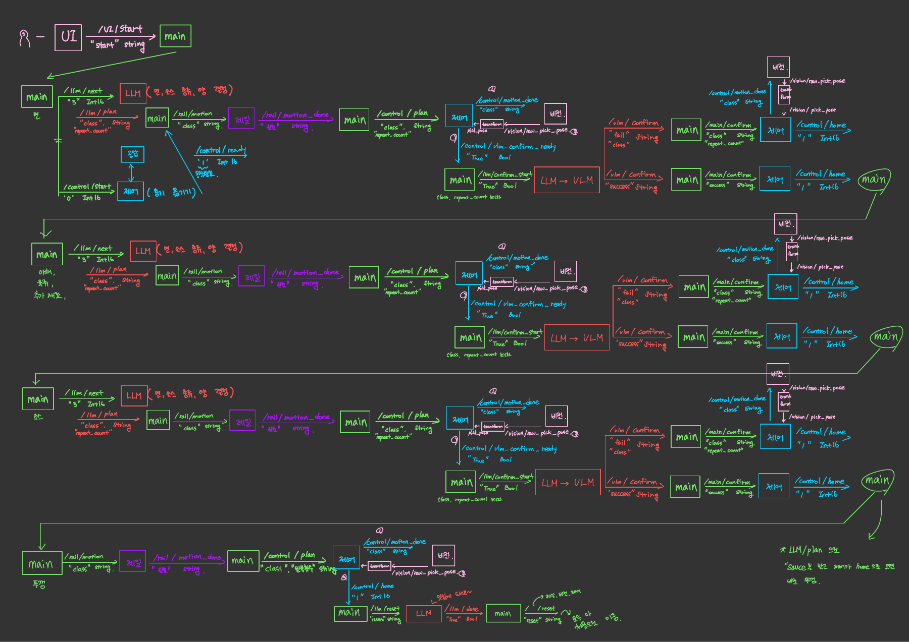
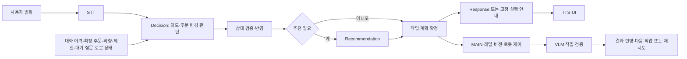

# IRC SOOMAC 3.0 — LLM·VLM 기반 밀키트 자동 포장 매니퓰레이터

[GitHub용 요약 README로 돌아가기](../README.md)

참고: **IRC PPT 최종**(2026-11-13) → 개발 배경·구조 변천사·시각 검증 흐름의 발표 자료이다.

참고: [기존 실행 검증](2026-11-05_hf_vllm_compare_review.md), [운영 적용 기록](2026-11-05_d6_prompt_adoption.md) → 실행 환경과 모델 선택은 이전에 사용한 버전을 기준으로 한다.

2026 지능로봇대회 동국대학교 **수맥** 팀의 자연어 주문 기반 밀키트 포장 프로젝트이다. 고객이 재료·수량·취향·섭취 제한을 말하면 언어 모델이 주문과 실행 의도를 처리하고, 비전·로봇 제어가 재료를 포장하며, 시각 언어 모델이 작업 결과를 확인한다.

소스 기준은 `b80a8cb`(2026-11-19, 대회 최종본)이다. 이 문서에는 정적 도식만 사용한다.

## 개발 환경

**2026-11-05 실제 실행·평가에 사용한 환경을 유지한다.** 새 버전 설치나 학습을 실행의 선행 조건으로 삼지 않는다. 상세 경로·설정은 [실행 환경 명세서](ENVIRONMENT.ko.md)에 정리했다.

| 구성 | 기존 실행 환경 |
|---|---|
| 운영체제·통신 | Ubuntu 22.04, ROS 2 Humble |
| GPU·드라이버 | NVIDIA RTX PRO 4500 Blackwell, 32623MiB, NVIDIA 드라이버 `580.178.04` — 기존 측정 장비 |
| LLM/VLM 기반 모델 | Gemma 4 12B, NF4 양자화·BF16 계산, vLLM 서버 공유 |
| 로컬 음성 | Qwen3-ASR-1.7B + Silero VAD / Fun-CosyVoice3-0.5B-2512 |
| 비전·제어 | RGB-D 카메라, YOLO OBB·SAM2, 6축 Dynamixel 매니퓰레이터·그리퍼·레일·흡착 장치 |

### 역할별 Python 환경

| 역할 | 환경 / Python | 기존 실행 버전 | 전체 패키지 기록 |
|---|---|---|---|
| LLM ROS 클라이언트 | `soomac_llm` / `3.10.20` | torch `2.12.1+cu130`, transformers `5.14.1`, peft `0.21.0`, bitsandbytes `0.50.2`, xgrammar `0.2.8`, langgraph `1.0.8` | [148개 버전](environment/soomac_llm.requirements.txt) |
| GPU 추론 서버 | `soomac_vllm_server` / `3.12.16` | vllm `0.32.0`, torch `2.13.0`, transformers `5.19.0`, bitsandbytes `0.50.2`, **vllm-bnb-plugin `0.0.3`** | [202개 버전](environment/soomac_vllm_server.requirements.txt) |
| STT | `gemma4_env` / `3.10.20` | torch `2.12.1+cu130`, transformers `5.13.1` | [217개 버전](environment/gemma4_env.requirements.txt) |
| TTS·UI | `cosyvoice3` / `3.10.19` | torch `2.10.0`, transformers `4.51.3`, sounddevice `0.5.5`, soundfile `0.12.1` | [229개 버전](environment/cosyvoice3.requirements.txt) |

패키지 목록은 당시 검증의 `BEFORE.json`을 그대로 옮긴 버전 기록이다. 기존 Conda 환경·모델·로컬 플러그인·ROS·시스템 라이브러리도 함께 유지한다. 기록 파일에 대한 무조건적인 `pip install -r`로 기존 환경을 덮어쓰지 않는다. [환경 기록 출처](ENVIRONMENT.ko.md#기존-실행-기록과-버전-고정)를 참고한다.

## 밀키트 시장의 한계

재료를 미리 조합한 밀키트는 유통기한이 짧은 재료가 상품 전체의 판매 기간을 제한한다. 고정된 메뉴만 고르는 방식으로는 고객의 취향이나 알레르기 등 섭취 제한을 세부적으로 반영하기도 어렵다.

## 해결 방안

**주문 시점에 고객이 고른 재료와 양으로 조합 포장한다.** 자연어 대화로 원하는 구성을 정하고, 추천·수정·실행 요청을 같은 주문 상태에 이어서 반영한다.

## 개발 내용

1. **자연어 주문 처리:** 음성을 텍스트로 바꾸고, 주문·취향·제한·실행 의도를 해석한다.
2. **로봇 작업 수행:** 실행 계획을 MAIN·레일·비전·제어에 전달해 재료를 옮긴다.
3. **작업 결과 검증:** 참조 이미지와 작업 전후 이미지를 비교해 다음 작업으로 진행할지 판단한다.

원본은 `Downloads/토픽_vlm 추가 v2.pdf`이다. 발표용 전체 흐름을 보여 주는 정적 도식이며, 세부 메시지 이름보다 역할 간 연결을 중심으로 읽는다.

## 기본 모델 선정 과정

언어 처리와 시각 검증에 각각 큰 모델을 올리는 메모리 부담을 줄이기 위해 **Gemma 4 12B 기반 모델 하나를 공유**한다. 언어 처리에서는 판단·추천·응답 역할에 해당하는 LoRA 어댑터를 선택하고, 시각 검증에서는 언어용 어댑터 없이 기반 모델을 사용한다. 호출은 역할별로 순차 진행한다.

## LLM 구조 개발 과정

| 단계 | 구성 | 다음 구조로 바뀐 이유 |
|---|---|---|
| 도구 호출(tool calling) | 모델의 도구 호출로 주문 처리 | 스트리밍 중 출력 파싱과 복합 요청 처리가 어려웠다. |
| 단일 에이전트(single agent) | XGrammar로 JSON 출력을 구조화 | 판단·추천·응답 역할이 섞이고 일반 대화 대응에 한계가 있었다. |
| 멀티에이전트(multi-agent) | Decision·Recommendation·Response를 분리하고 LangGraph로 연결 | 역할별 입력·출력과 공유 상태를 나눠 복합 주문과 멀티턴 처리를 구성했다. |

### 개발 시점

| 시점 | 저장소에서 확인되는 변화 |
|---|---|
| 2026-08~09 | ROS 통합, 다중 이미지 입력, LoRA 적용 기록 |
| 2026-09-29~10 | LangGraph 멀티에이전트 전환, 대화 이력·주문 상태·추천 처리 보완, Qwen ASR 추가 |
| 2026-11-01~02 | vLLM 추론 최적화와 Unsloth 학습 가속 적용 |
| 2026-11-05 | Decision epoch6·Recommendation epoch6·Response step150 운영 적용, 공통 접두 워밍업 |
| 2026-11-19 | 대회 최종본 `b80a8cb` |

## LangGraph 기반 멀티에이전트 구조

| 역할 | 입력과 처리 | 결과 |
|---|---|---|
| Decision | 사용자 발화와 대화 이력·주문·취향·대기 질문·로봇 상태를 읽는다. | 대화 유형, 주문 변경, 추천·확인·실행 의도를 구조화한다. |
| Recommendation | 추천이 필요한 경우 현재 주문과 취향·섭취 제한을 읽는다. | 재료·수량 후보와 추천 이유를 만든다. |
| Response | 실제 반영된 상태·처리 결과와 대화 유형을 읽는다. | 고객에게 결과를 안내하거나 일반 대화에 응답한다. |
| 상태·실행 관리 | 모델 출력 형식과 실행 조건을 검사하고 공유 상태를 갱신한다. | 실행 계획과 응답 경로를 결정한다. 실행 시작 안내에는 기존 고정 문장을 사용한다. |

**확정 주문과 추천 후보를 구분하며, 실행 허용과 실제 작업 완료도 따로 관리한다.** 이전 턴의 발화와 응답을 다음 턴에 전달하므로 수량 정정·추천 수락·지시어를 대화 흐름 안에서 처리한다. 구조적 모순은 한 번 재검토하고 해결되지 않으면 확인 질문으로 연결한다.

(내가 의역해보자면, “치즈를 추천받음”, “치즈를 주문에 넣음”, “지금 치즈를 담기로 함”, “실제로 치즈를 담음”을 서로 다른 상태로 다루는 것이다.)

## 대화 로그 기반 데이터셋 구성 및 QLoRA 파인튜닝

실제 대화의 발화·모델 판단·주문 전후 상태를 수집한다. 복합 요청 누락, 수량 변경, 추천 수락, 실행 의도 오류를 분석해 데이터와 프롬프트를 보강하고, 역할별 QLoRA 학습과 재평가를 반복했다.

| 역할 | 최종 적용 어댑터 |
|---|---|
| Decision | r5 Unsloth, epoch6 / step1638 |
| Recommendation | r5 Unsloth, epoch6 / step234 |
| Response | r5 Unsloth, best step150 / 약 epoch1.44 |

현재 모델 선택의 정본은 [model_runtime.py](../src/soomac_irc/soomac_irc/model_runtime.py)의 직접 경로이며, [llm_active_stack.json](../config/llm_active_stack.json)은 선택 정보를 기록한다. 가중치와 외부 학습 작업장은 Git clone에 포함되지 않는다.

## 학습 및 추론 최적화

추론은 vLLM의 접두 캐싱(prefix caching)과 시작 워밍업을 사용한다. 동일한 프롬프트 앞부분의 KV 캐시를 재사용해 반복 입력 계산을 줄인다. 학습에는 Unsloth를 적용했다.

| 구분 | 기존 실행·평가에서 확인한 결과 | 측정 범위 |
|---|---|---|
| HF 캐시 ON → vLLM 캐시 ON | warm 요청 24회 합계 `34.36초 → 14.76초` | 같은 입력의 반복 요청; 음성·로봇 시간 제외 |
| 공통 접두 시작 워밍업 | 준비 `5.79초`, 후속 첫 D→Q→P 요청 `2.839초` | 다른 실제 입력에서 접두 재사용 확인; 단회 관측 |
| Unsloth 학습 | 발표 자료의 역할별 스텝 시간 감소 약 `24~31%` | 해당 학습 조건의 비교 |

근거: [HF/vLLM 비교](2026-11-05_hf_vllm_compare_review.md), [시작 워밍업](2026-11-05_startup_warmup_plan.md). 입력·출력 길이와 캐시 상태에 따라 지연이 달라진다.

## 참조 이미지 선정

라벨링된 식재료 이미지에서 경계 상자(bounding box) 영역을 잘라 참조 후보를 만든다. SigLIP2 임베딩을 Chroma DB에 저장하고, 재료별 임베딩 평균과의 코사인 유사도를 이용해 대표 참조 이미지를 선택한다.

## 작업 전후 이미지 검증

VLM에는 **참조 이미지·작업 전 이미지·현재 이미지**를 제공한다. 기존에 들어 있던 재료와 이번 작업으로 새로 들어간 재료를 비교해 성공·실패·불확실을 판단하고, 기존 제어 흐름에 따라 진행·재시도에 연결한다.

## 개별 재료 검출 / 뚜껑 인식

발표 자료의 개별 재료 검출 흐름은 **YOLO OBB 영역 검출 → 깊이 기반 후보점 생성 → SAM2 분할 → 실제 크기 비교**이다. 검출 위치는 좌표 변환을 거쳐 로봇 제어에 전달한다. 뚜껑 인식은 색상·깊이 마스크, 모폴로지 연산, 컨투어 추출과 평면 fitting으로 설명한다. 현장 비전·레일 구현과 가중치는 별도 자산도 포함한다.

## STT 모델 선정 과정

CLOVA API와 로컬 Nemotron을 비교한 뒤, 주문 발화의 단어 인식 결과를 기준으로 Qwen3-ASR-1.7B를 최종 선택했다. Silero VAD로 발화 구간을 검출하고 300ms 사전 버퍼를 붙여 첫 음절 누락을 줄인다. 약 0.8초 무음으로 발화 종료를 판단한다. TTS·작업 중 수음 게이트와 버퍼 초기화로 출력 음성이 다시 주문으로 들어오는 것을 막는다.

## TTS 모델 선정 과정 / TTS 시행착오(전·후처리)

CosyVoice3의 참조 음성 기반 합성을 사용한다. 마크다운·특수문자·공백을 정리하고 숫자·단위를 한국어 읽기 형태로 바꾼 뒤 스트리밍 재생한다. **최종 TTS는 기존 Hugging Face 경로를 유지한다.** 별도 TTS vLLM 시험은 [기존 유지 결론](2026-11-05_tts_vllm_trial_review.md)에 따라 운영에 채택하지 않았다.

## 복합 발화 및 멀티턴 대화 평가 결과

| 검증 | 결과 |
|---|---|
| 필수 복합·분리 주문 및 실행 | 17/17턴 |
| 누적 멀티턴 주문·상태·계획·실행 | 80/82턴 |
| 누적 멀티턴 전체 계약 | 77/82턴 |

모델이 만든 상태와 대화 이력을 다음 턴으로 이어서 평가했다. 짧은 수락 표현의 실행 시점, 일부 일반 대화·작업 분류에는 오류가 남았다. [운영 적용 결과](2026-11-05_d6_prompt_adoption.md)를 참고한다.

별도 [음성 상주 5개 시나리오 시험](2026-11-05_full_scenario_audio_warmup_review.md)은 네 조건 합계 144/144턴을 통과했다. 이는 해당 대본·격리 조건의 결과이며, 마이크 입력부터 실물 로봇 작업까지의 전체 검증을 뜻하지 않는다.

## 실행

기존 PC에서는 이미 준비된 네 Python 환경과 모델·참조 이미지 DB를 그대로 사용한다. **기존 TTS 실행 함수는 장치 프로필 전환·복구도 수행하므로 보존한다.**

각각 별도 Bash 터미널에서 아래 명령을 실행한다. `source ~/.bashrc`로 기존 실행 함수·별칭을 먼저 정의한다.

1. vLLM 서버: `source ~/.bashrc` 후 `soomac_vllm_server`
2. LLM: `source ~/.bashrc` 후 `soomac_llm`
3. STT: `source ~/.bashrc` 후 `stt_qwen`
4. TTS: `source ~/.bashrc` 후 `soomac_tts`
5. UI: `source ~/.bashrc` 후 `soomac_ui`, 브라우저 `http://127.0.0.1:5000`

이 자리에서 살아있는 변수·명령: 위 다섯 함수·별칭은 기존 PC의 `~/.bashrc`에서 정의되며 이번 작성 시 파일로 확인했다. Git clone만으로 셸 함수가 설치되지는 않는다. 함수 없이 실행하는 명령과 로봇 제어 스택의 준비 조건은 [실행 환경 명세서 §5](ENVIRONMENT.ko.md#5-준비와-실행-순서)에 있다.

기존 서빙값은 입력+출력 `16384`, GPU 예약률 `0.58`, batch invariant ON이다. 12K/0.50은 별도 시험 후보로만 기록돼 있으므로 기본 실행값을 임의로 바꾸지 않는다. 동시 부하 결과는 [메모리 측정](2026-11-05_stack_vram_12k_review.md)을 참고한다.

## 저장소 구성

| 경로 | 역할 |
|---|---|
| [src/soomac_irc](../src/soomac_irc) | LLM·VLM·STT·TTS·UI, 프롬프트·상태 계약과 관련 테스트 |
| [src/irc_control_pkg](../src/irc_control_pkg) | MAIN·매니퓰레이터 제어·비전·좌표 변환 |
| [tools](../tools) | vLLM 시작·어댑터 변환·학습·평가 도구 |
| [docs](../docs) | 실행 환경·설계·개발 이력·검증 결과 |
| [models](../models) | 모델 선택 기록과 로컬 어댑터 배치; 대용량 가중치는 Git 제외 |

## 기대효과

자연어로 개인 취향과 섭취 제한을 반영하고, 주문 시점에 구성하는 맞춤 밀키트 포장을 목표로 한다. 대화·작업 로그는 오류 분석과 운영 관리에 활용한다. 폐기량 감소와 현장 생산성 개선은 기대효과이며 이 저장소의 대화 평가 수치와 구분한다.

## 용어 정리

| 용어 | 의미 |
|---|---|
| 대규모 언어 모델(LLM) / 시각 언어 모델(VLM) | 각각 자연어 주문 처리 / 이미지 기반 작업 검증을 맡는다. |
| 에이전트(agent) / 어댑터(adapter) | 각각 판단·추천·응답 역할 / 기반 모델에 적용하는 역할별 LoRA 가중치이다. |
| 상태(state) / 대화 이력(history) | 각각 현재 주문·제한·대기 질문·작업 상황 / 이전 발화·응답 기록이다. |
| QLoRA / 양자화(quantization) | 각각 양자화된 모델 위의 LoRA 학습 / 가중치 표현의 메모리를 줄이는 방식이다. |
| 접두 캐싱(prefix caching) / 워밍업(warmup) | 각각 공통 입력 앞부분의 KV 캐시 재사용 / 사용자 입력 전에 해당 경로를 준비하는 호출이다. |
